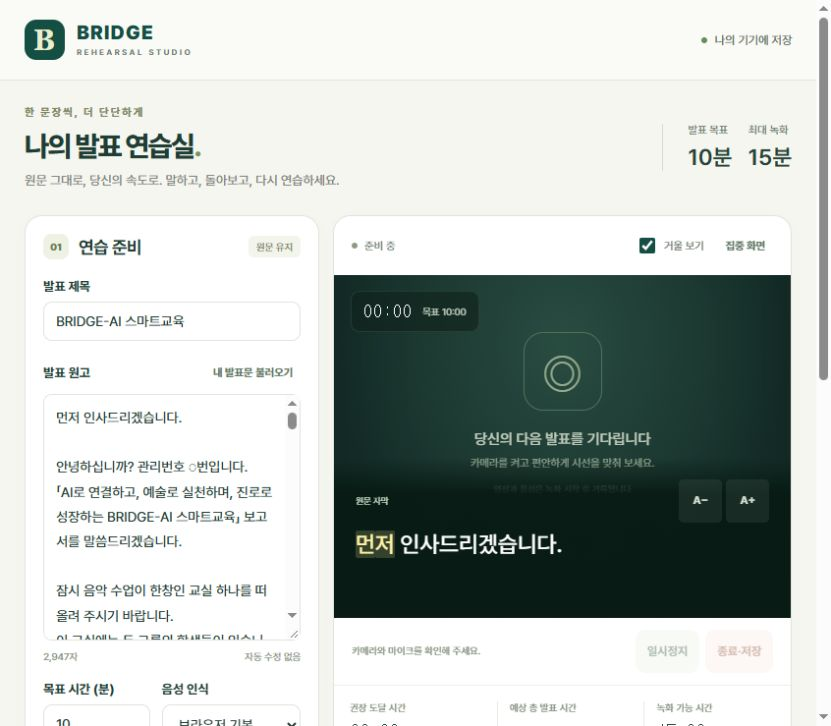

# BRIDGE · 발표 연습실

원고를 토씨 하나 빠뜨리지 않고 암기하기 위한 촬영 연습 웹앱입니다. 앱 소스, 서버, 테스트, PRD를 모두 포함합니다. 별도의 프런트엔드 빌드나 패키지 설치 없이 실행할 수 있습니다.



## 바로 실행하기

1. ZIP을 압축 해제합니다.
2. Node.js 22 이상을 설치합니다.
3. 이 폴더에서 다음 명령을 실행합니다.

```sh
node server.mjs
```

4. 브라우저에서 **http://localhost:4173** 을 엽니다.

Windows에서는 `start-windows.cmd`를 실행해도 됩니다. `dist/index.html`을 더블클릭하는 방식은 사용하지 마세요. 카메라·모듈·파일 불러오기에 웹서버가 필요합니다.

## 사용 순서

1. **내 발표문 불러오기**를 누르거나 발표 원고를 붙여넣습니다.
2. 미정 관리번호·기관명과 발음 대응 설정을 확인합니다. 원문은 자동으로 고치지 않습니다.
3. 목표 시간을 정합니다. 기본 10분, 녹화 한도는 15분입니다.
4. 음성 인식 방식을 선택하고 오디오 전송 안내를 확인합니다.
5. **카메라 확인 → 연습 시작**을 누릅니다. 3초 카운트다운 뒤 녹화합니다.
6. 원문 자막에서 초록색은 인식 일치, 주황색 점선은 검토 후보, 노란색은 현재 추적 위치입니다.
7. 종료 후 **다시 보기·저장**에서 영상을 재생하고 **영상 저장**으로 파일을 내보냅니다.

발음 설정 예시:

```text
AI=에이아이
BRIDGE=브리지
ME=미
WE=위
2.57=이점오칠
3.28=삼점이팔
0.71=영점칠일
```

사용자가 제공한 발표문은 `dist/sample.txt`에 있습니다. 구분선과 글머리표만 제외했고, 문장 속 오탈자로 보이는 표현도 임의로 고치지 않았습니다. 확정 원고로 수정한 뒤 연습하세요.

## 포함된 기능

- 휴대폰·태블릿·PC용 반응형 화면과 집중 화면
- 전면 카메라 미리보기, 거울 보기, 음성 포함 녹화
- 원문 하단 자막, 글자 크기 조절, 자동 추적과 수동 위치 복구
- 조사·어미까지 비교하는 문자 정렬과 인식 불확실 구간 표시
- 경과 시간, 권장 도달 시간, 예상 총 시간과 가로 막대
- 일시정지를 제외한 누적 15분 한도, 14분·14분 30초 안내, 자동 종료
- 브라우저 IndexedDB에 녹화 조각 저장, 연습 목록, 삭제, 파일 저장·공유
- 영상 재생 시 원문 대조 표시, 검토 후보로 이동, 인식 오류/실제 발화 차이 확인
- 대조 기록 JSON 내보내기

## 음성 인식 선택

| 방식 | 필요한 설정 | 특징 |
|---|---|---|
| 브라우저 기본 | 앱용 API 키 없음 | Web Speech API를 지원하는 브라우저에서 동작. 브라우저 제공자가 오디오를 처리할 수 있음 |
| 서버 연결 | 서버 API 키와 이용 비밀번호 | 5초 내외의 WAV 조각을 서버를 거쳐 OpenAI로 전송. 약 0.6초 중첩으로 경계 단어 손실을 완화 |
| 녹화 전용 | 없음 | 영상·타이머 사용. 자막 위치는 직접 선택 |

브라우저 기본 음성 인식은 모든 모바일 환경에서 제공되지 않습니다. 미지원 또는 불안정한 환경에서는 서버 연결을 사용하세요. 서버 방식은 5초 정도의 수집 시간에 서비스 처리 시간이 추가되며, 즉시 단어 단위로 반응하는 방식은 아닙니다. 실제 기기와 네트워크에서 확인해야 합니다.

### 서버 음성 인식 설정

`.env.example`을 `.env`로 복사하고 다음 값을 설정합니다.

```dotenv
OPENAI_API_KEY=본인의_OpenAI_API_키
APP_PASSWORD=직접_정한_긴_무작위_비밀번호
TRANSCRIBE_MODEL=gpt-4o-mini-transcribe
PORT=4173
HOST=127.0.0.1
```

```sh
node --env-file-if-exists=.env server.mjs
```

앱에서 **서버 연결**을 선택하고 `APP_PASSWORD` 값만 입력합니다. API 키는 서버에만 둡니다. 이용 비밀번호는 브라우저 저장소에 저장하지 않습니다. 서버 이용에는 해당 API 계정의 사용 요금이 발생할 수 있습니다.

외부 HTTPS 서버로 배포할 때는 호스팅 서비스의 환경 변수에 키와 비밀번호를 설정하세요. 필요하면 `HOST=0.0.0.0`, `PUBLIC_ORIGIN=https://실제도메인`을 설정합니다. 다중 사용자 서비스에는 계정 인증과 사용자별 할당량을 추가해야 합니다. 현재 서버는 개인 연습용 공유 비밀번호와 요청 제한을 사용합니다.

## GitHub에 한 번에 올리기

압축을 해제한 뒤 **이 폴더 안의 파일 전체**를 저장소 루트에 추가합니다. ZIP 파일 자체만 올리는 대신 압축을 풀어 올려야 앱 파일과 문서를 바로 사용할 수 있습니다. 숨김 폴더 `.github`도 포함해야 합니다.

```text
bridge-rehearsal/
├── README.md
├── package.json
├── server.mjs
├── start-windows.cmd
├── .env.example
├── .gitignore
├── .github/workflows/pages.yml
├── dist/                      # 실행되는 앱 파일
│   ├── index.html
│   ├── styles.css
│   ├── app.js
│   ├── core.js
│   ├── speech.js
│   ├── storage.js
│   ├── pcm-worklet.js
│   ├── icon.svg
│   └── sample.txt
├── docs/
│   ├── PRD.md                 # 전체 제품 요구사항
│   ├── IMPLEMENTATION.md      # 실제 구현 범위와 제한
│   ├── TESTING.md             # 자동 검사와 실제 기기 점검
│   └── PRIVACY.md             # 데이터 저장·전송 안내
└── tests/                     # Node.js 자동 테스트
```

### GitHub Pages로 휴대폰에서도 열기

저장소의 **Settings → Pages → Build and deployment → Source**에서 **GitHub Actions**를 선택합니다. 기본 브랜치가 `main`이면 동봉된 워크플로가 테스트 후 `dist/`를 게시합니다. 다른 브랜치를 사용한다면 `pages.yml`의 브랜치 이름을 맞추세요. Actions 탭에서 직접 실행할 수도 있습니다.

생성된 HTTPS 주소를 휴대폰·태블릿에서 열면 됩니다. Pages는 정적 앱만 실행하므로 **브라우저 기본 인식과 녹화 전용**을 사용합니다. **서버 연결까지 사용하려면 Node.js 서버를 HTTPS 지원 호스팅에 배포**해야 합니다. API 키를 GitHub Pages나 `dist/`에 넣지 마세요.

카메라·마이크에는 HTTPS 또는 localhost가 필요합니다. 휴대폰에서 PC의 `http://192.168...` 주소로 접속하는 방식은 카메라 사용 조건을 충족하지 않을 수 있습니다.

현재 패키지는 GitHub 업로드용 파일입니다. 실제 저장소 생성이나 외부 배포는 수행하지 않았습니다.

## 영상은 어디에 저장되나요?

기본 저장 위치는 **현재 기기의 현재 브라우저 내부 저장소**입니다. 서버나 GitHub에 영상이 자동 업로드되지 않습니다. 파일로 내보내면 PC는 다운로드/선택 폴더, 모바일은 지원되는 다운로드·파일 앱·공유 경로를 사용합니다. 사진 앱 저장은 지원하는 기기에서 공유 메뉴로 선택합니다.

브라우저 데이터 삭제나 저장 공간 회수로 내부 영상이 사라질 수 있습니다. 중요한 영상은 파일로 저장하세요. 서로 다른 기기나 브라우저의 기록은 자동 동기화되지 않습니다.

## 검사 실행

```sh
node --test tests/core.test.mjs tests/server.test.mjs tests/app.test.mjs
```

자식 프로세스 실행이 제한된 환경에서는 Node.js 22.8 이상에서 다음 명령을 사용합니다.

```sh
node --test --test-isolation=none tests/core.test.mjs tests/server.test.mjs tests/app.test.mjs
```

12개 자동 검사와 데스크톱 화면 확인을 수행했습니다. 실제 기기의 카메라·마이크와 15분 연속 녹화 검증은 [테스트 안내](docs/TESTING.md)를 따르세요. 현재 검증 범위를 [구현 현황](docs/IMPLEMENTATION.md)에 명시했습니다.

## 문서와 참고

- [제품 요구사항 PRD](docs/PRD.md)
- [구현 현황과 제한](docs/IMPLEMENTATION.md)
- [테스트 안내](docs/TESTING.md)
- [데이터 처리 안내](docs/PRIVACY.md)
- [MDN: SpeechRecognition 지원과 동작](https://developer.mozilla.org/en-US/docs/Web/API/SpeechRecognition)
- [MDN: 카메라·마이크 보안 컨텍스트](https://developer.mozilla.org/en-US/docs/Web/API/MediaDevices/getUserMedia)
- [OpenAI: 음성 전사 API](https://developers.openai.com/api/reference/resources/audio/subresources/transcriptions/methods/create)
